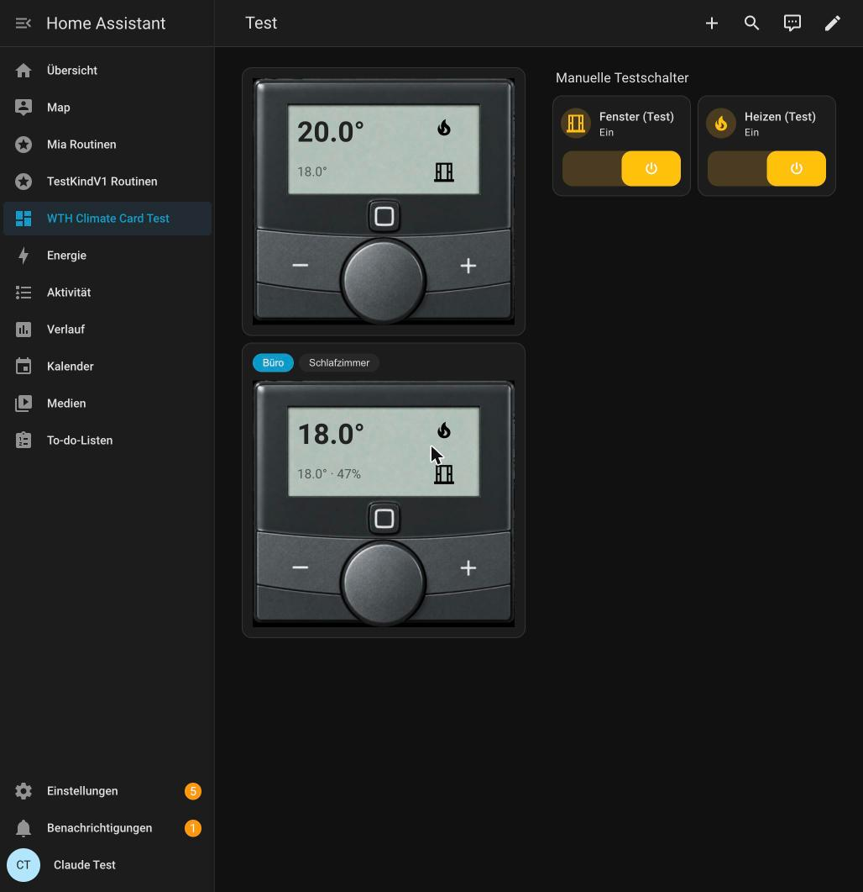

# WTH Climate Card

A Home Assistant Lovelace card for people who are sick of a dozen identical
thermostat widgets stacked on top of each other.

Instead of one card per room, WTH Climate Card gives you **one card for your
whole house**: a wall-thermostat-styled display you flip through room by room
with a tab bar, modeled after the look of a real **Homematic IP WTH2**
wall thermostat — which is exactly what's mounted on the walls here.



## Why

Most dashboards end up with a thermostat card per room, all identical, all
taking up space, none of them telling you anything at a glance. This card
was built to replace that wall of duplicate widgets with a single, clean
display that looks (and behaves) like an actual thermostat on the wall.

## Features

- **One card, every room.** Add as many rooms as you like; switch between
  them with the chip selector at the top.
- **Works with any `climate.*` entity**, not just Homematic IP devices — the
  WTH2 look is just the default skin, the card itself is generic.
- **Configurable display rows.** Pick what the large (top) and small
  (bottom) row show using Home Assistant's native "state content" picker —
  search and add target temperature, current temperature, humidity, state,
  or any other attribute the entity exposes, reorder them by dragging, or
  type your own free-text value (e.g. a literal `-`). Combine as many as you
  like, joined together (e.g. `18.0° · 47%`).
- **Configurable separator.** Choose how combined values are joined — middle
  dot, dash, space, asterisk, slash, or type your own.
- **Smart icons.** The flame and window icons only show up when they're
  actually relevant: the flame appears only while the thermostat reports
  active heating, and the window icon only appears when a window sensor (or
  helper) is configured *and* available — no icon clutter for rooms that
  don't have one.
- **Freely assignable center button.** Wire it up to anything Home
  Assistant's action editor supports: more-info, navigate, a script, a
  scene, whatever fits.
- **+ / − buttons** step the target temperature using the entity's own
  step size and min/max limits.

## Installation

### HACS (recommended)

1. In Home Assistant, go to **HACS → ⋮ → Custom repositories**.
2. Add `https://github.com/jacky-coke/wth-climate-card` as the repository
   URL and pick **Dashboard** as the category.
3. Install "WTH Climate Card" and reload your browser.

### Manual

1. Copy `dist/wth-climate-card.js` from this repo into
   `<config>/www/wth-climate-card/wth-climate-card.js`.
2. Add it as a Lovelace resource (**Settings → Dashboards → ⋮ → Resources**):
   - URL: `/local/wth-climate-card/wth-climate-card.js`
   - Resource type: JavaScript Module

## Usage

Add the card through the dashboard UI (search for "WTH Climate Card" when
adding a card) or via YAML:

```yaml
type: custom:wth-climate-card
entities:
  - entity: climate.living_room
    name: Living Room
    window_entity: binary_sensor.living_room_window
    top_values:
      - current_temperature
    bottom_values:
      - temperature
      - current_humidity
    separator: " - "
    tap_action:
      action: more-info
  - entity: climate.bedroom
    name: Bedroom
```

| Option           | Required | Description                                                                 |
| ---------------- | -------- | ----------------------------------------------------------------------------|
| `entity`         | yes      | A `climate.*` entity.                                                       |
| `name`           | no       | Display name for the room tab. Defaults to the entity's friendly name.      |
| `window_entity`  | no       | A `binary_sensor` (or helper) that shows the window icon when `on`.         |
| `tap_action`     | no       | Action for the center button. Defaults to no action.                       |
| `top_values`     | no       | List of entity attributes (e.g. `temperature`, `current_temperature`, `current_humidity`, `state`) or free text, shown in the large row. Default: `temperature`. |
| `bottom_values`  | no       | Same as above, for the small row. Default: `current_temperature`.          |
| `separator`      | no       | String joining multiple values within a row. Default: `" · "`.             |

All of this is also configurable through the visual card editor — no YAML
required.

## License

MIT, see [LICENSE](LICENSE).
